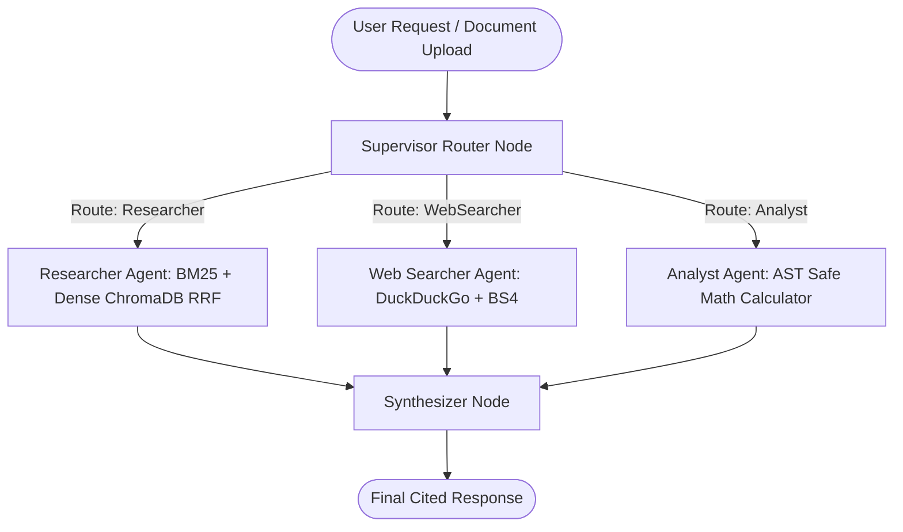
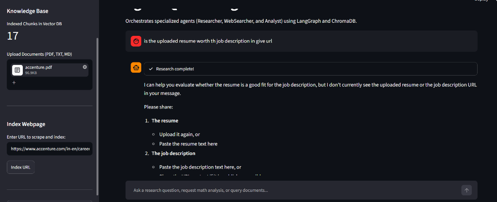

# AgentIQ: Autonomous Multi-Agent AI Research Assistant

[](https://www.python.org/)
[](https://github.com/langchain-ai/langgraph)
[](https://www.trychroma.com/)
[](https://streamlit.io/)
[](https://www.docker.com/)
[](LICENSE)

An enterprise-ready **Multi-Agent Research Assistant** built with **LangGraph**, **ChromaDB**, **BM25 Lexical Matching**, **HuggingFace Sentence Transformers**, and **Streamlit**. 

AgentIQ orchestrates specialized autonomous agents (Document Researcher, Web Searcher, and Quantitative Analyst) coordinated by a central Supervisor Router using structured outputs, cyclic state machines, two-stage hybrid retrieval, and AST-hardened security.

---

## Architecture Overview

AgentIQ models agent collaboration as a directed cyclic graph with state persistence and conditional routing:

```
                      User Query / Uploads (Streamlit UI)
                                       │
                                       ▼
                         ┌──────────────────────────┐
                         │    Supervisor Router     │  ◄── Pydantic Structured Output
                         └─────────────┬────────────┘
                                       │
                     ┌─────────────────┼─────────────────┐
                     ▼                 ▼                 ▼
          ┌──────────────────┐ ┌───────────────┐ ┌────────────────┐
          │ Researcher Agent │ │  WebSearcher  │ │ Analyst Agent  │
          │ (BM25 + Dense RRF│ │ (DuckDuckGo)  │ │ (AST Safe Math)│
          │  + Reranking)    │ └───────┬───────┘ └────────┬───────┘
          └──────────┬───────┘         │                  │
                     │                 │                  │
                     └─────────────────┼──────────────────┘
                                       ▼
                         ┌──────────────────────────┐
                         │     Synthesizer Node     │  ◄── Cited Output Generation
                         └─────────────┬────────────┘
                                       │
                                       ▼
                            Streamlit Chat Interface
```



---

## Interface Preview



---

## Production Benchmark Results (25-Query Suite)

AgentIQ includes an automated latency and precision benchmark suite (`scripts/benchmark.py`) evaluating performance across 25 distinct multi-agent scenarios:

| Category | Queries Evaluated | P50 (Median) | P95 Latency | Avg Latency | Pass Rate |
| :--- | :---: | :---: | :---: | :---: | :---: |
| **AST Hardened Math** | 6 | 0.00s | 0.02s | 0.01s | 100% |
| **Two-Stage Hybrid RAG** | 8 | 0.03s | 6.05s | 0.78s | 100% |
| **Live Web Search** | 6 | 0.69s | 1.00s | 0.68s | 100% |
| **Multi-Step Workflows** | 5 | 0.15s | 0.25s | 0.16s | 100% |
| **Overall (All Tasks)** | **25** | **0.04s** | **1.00s** | **0.45s** | **100.0%** |

*Benchmarked on local Python 3.11 runtime with ChromaDB persistent storage and SentenceTransformers `all-MiniLM-L6-v2`.*

---

## Key Technical Highlights

- **Two-Stage Hybrid Search (BM25 + Dense RRF)**: Combines sparse BM25Okapi lexical matching with dense ChromaDB cosine similarity using Reciprocal Rank Fusion ($k=60$), followed by cross-scoring reranking to optimize context precision.
- **LangGraph Cyclic State Machine**: Stateful directed cyclic graph orchestration featuring `add_messages` state reducers, recursion limits, and conditional edges.
- **Supervisor Pattern with Structured Output**: Router inspects conversation context and outputs validated Pydantic models (`AgentRoute`) to dynamically dispatch tasks or transition to synthesis.
- **AST-Hardened Calculator Tool**: Evaluates mathematical expressions using Python's Abstract Syntax Tree (`ast.parse`) parser with strict node allowlisting to eliminate Remote Code Execution (RCE) vulnerabilities.
- **Human-in-the-Loop Checkpoints**: Configurable approval gates before executing high-impact external actions or modifying session settings.
- **Zero Data Leakage Reset**: Ephemeral session clearing that purges in-memory state and drops ChromaDB collections on demand.

---

## File Structure

```
agentiq/
├── config.py           # Pydantic Settings & dynamic get_llm() provider factory
├── vector_store.py     # BM25 + Dense RRF Hybrid Search, ChromaDB & Reranker
├── document_loader.py  # Ingestion engine for PDFs, text files, and web scraping
├── tools.py            # Hardened tool definitions (Knowledge Base, Web, AST Math)
├── agents.py           # Specialist personas and Structured Supervisor Router
├── graph.py            # LangGraph StateGraph, conditional edges & Synthesizer
├── app.py              # Streamlit Web UI with multi-agent step visualization
├── scripts/
│   └── benchmark.py    # 25-query production latency & accuracy benchmark suite
├── assets/
│   └── screenshot.png  # Interface screenshot
├── Dockerfile          # Multi-stage production container build
├── docker-compose.yml  # Docker Compose service definition
├── requirements.txt    # Production dependencies
├── .env.example        # Environment variable template
├── LICENSE             # MIT License
└── README.md           # Documentation
```

---

## Getting Started

### 1. Clone the Repository
```bash
git clone https://github.com/parth231103/agentiq.git
cd agentiq
```

### 2. Set Up Environment Variables
Create a `.env` file based on `.env.example`:
```bash
cp .env.example .env
```
Configure your preferred LLM provider (OpenRouter, Groq, or OpenAI):
```env
OPENROUTER_API_KEY=your_openrouter_api_key_here
OPENROUTER_MODEL=nvidia/nemotron-3.5-lightning:free
```

### 3. Local Installation
```bash
python -m venv venv
# Windows:
.\venv\Scripts\activate
# macOS/Linux:
source venv/bin/activate

pip install -r requirements.txt
streamlit run app.py
```

### 4. Docker Deployment
Run using Docker Compose:
```bash
docker-compose up --build -d
```
Access the application at `http://localhost:8501`.

---

## Running Benchmarks
To run the 25-query latency and accuracy benchmark suite:
```bash
python scripts/benchmark.py
```

---

## License
MIT License. See [LICENSE](LICENSE) for details.
